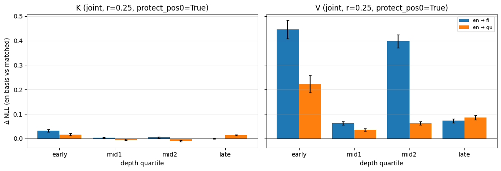
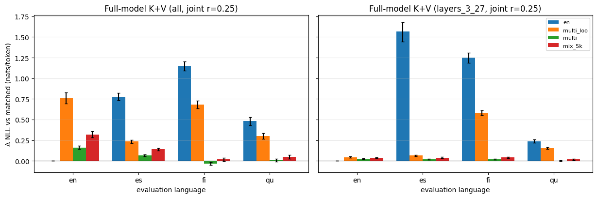
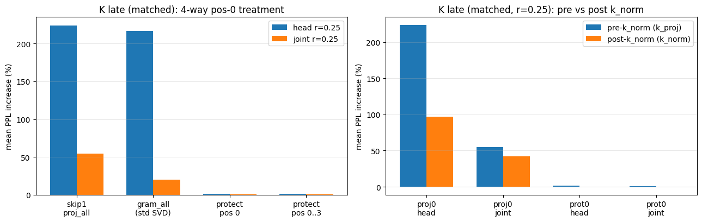

# Cross-Lingual Calibration Bias in Low-Rank KV-Cache Compression for Low-Resource Languages

**Author:** Maria Contreras ([Disentangle Lab](https://github.com/Disentangle-Lab)) · **License:** [MIT](LICENSE)

Systematic empirical study of **low-rank KV-cache compression** across high- and low-resource languages — **English (`en`)**, **Spanish (`es`)**, **Finnish (`fi`)**, and **Ayacucho Quechua (`qu`)** — on **Qwen3-1.7B** (28 layers, 16 query heads, 8 KV heads, `head_dim = 128`).

---

## Core Findings

1. **Across the entire network depth, Values (`V`) carry severe cross-lingual calibration bias while Keys (`K`) are nearly language-agnostic (once position 0 is protected).**
   - In late-layer `V` (layers 21–27, `r = 0.25·d`), English-only calibration penalizes Quechua by **`+0.267` nats/token** (`+35.5%` PPL vs `+3.7%` matched) on Wikipedia and **`+0.601` nats/token** (`+75.1%` PPL vs `-4.0%` matched) on parallel **FLORES-200** sentences.
   - Across all four depth quartiles (`early 0–6`, `mid1 7–13`, `mid2 14–20`, `late 21–27`, `joint r = 0.25`, `protect_pos0 = True`), `K` stays nearly immune to calibration language (`ΔNLL ∈ [-0.010, +0.032]`), whereas `V` exhibits massive cross-lingual penalties in `early` (`fi: +0.446`, `qu: +0.225`), `mid2` (`fi: +0.397`), and `late` (`qu: +0.086`, `fi: +0.073`).

2. **Standard full-sequence SVD (`SKIP_FIRST_TOKENS = 0`) fails to preserve the position-0 attention sink in `K` — explicit 1-token protection is mandatory.**
   - Even when position 0 is *included* in the calibration Gram matrix (`gram_all_proj_all`), late-layer `K` still explodes by **`+153%` to `+328%`** (`head r = 0.25`) and **`+42%` to `+88%`** (`head r = 0.75`), because position 0 is only `1/512` of tokens and has `0.33×` pre-`k_norm` norm (~0.02% of covariance trace).
   - **Mechanistic cause:** Two additive effects — (a) Qwen3's `k_norm` RMSNorm amplifies angular distortion of `K[0]` (`cos_sim = 0.689` vs `0.958` for `pos ≥ 1`; compressing *after* `k_norm` cuts the blow-up by >50%), and (b) `K[0]` itself carries an orthogonal attention-sink direction.
   - Simply leaving **1 token (`pos 0`) uncompressed** (`protect_pos0 = True`) drops late-layer `K` error from `+159–337%` to **`+1.15–1.99%`** (`pre-k_norm`) and **`-0.37%` to `+0.72%`** (`post-k_norm`). Protecting `pos 0..3` adds zero further benefit.

3. **Shared across-head projection (`joint`) cuts cross-lingual loss by 65–75% at the same rank budget.**
   - Replacing per-head projectors (`r = 32` per head) with a single layer-wide KV projector (`r = 256` shared across 8 KV heads) reduces the English-calibration penalty on Quechua from `+0.267` to **`+0.086` nats/token** on Wikipedia (`-68%`) and from `+0.601` to **`+0.147` nats/token** on FLORES-200 (`-76%`).

4. **Multilingual calibration without the target language (`multi_loo`) fails — but just ~5k target tokens unlock viable 4× full-model `K+V` compression.**
   - Averaging English + Spanish + Finnish calibration Grams (`multi_loo`) fails to rescue Quechua on both Wikipedia and parallel FLORES-200 (`+0.556` vs `+0.601` `head`).
   - Mixing just **`5k` tokens (~10 windows of 512 tokens)** of the target language at weight `w = 0.10` into a `joint` projector + `protect_pos0 = True` eliminates almost the entire gap:
     - **Late-layer `V` (FLORES-200 parallel):** `ΔNLL = -0.0296` (`flores_to_flores`), **`-0.0086`** (`wiki_to_flores`, cross-domain!).
     - **Full-model 4× `K+V` (`layers 3–27`, 89% of all layers!):** English-only calibration breaks even Spanish (`+427.6%`), Finnish (`+260.4%`), and Quechua (`+25.2%`), while **`joint` + `protect_pos0` + `mix_5k`** brings them down to **`+14.3%` (`es`)**, **`+7.3%` (`fi`)**, and **`+0.51%` (`qu`)** (and `multi` reaches **`-0.98%` on `qu`**, **`+4.79%` on `fi`**).

5. **Confirmed on strictly parallel text (FLORES-200).**
   - Replicating both calibration and evaluation on exact translated sentences (`eng_Latn`, `spa_Latn`, `fin_Latn`, `quy_Latn`) reproduces — and strengthens — every finding from Wikipedia, ruling out topic/domain confounders.

---

## Key Figures

### K vs V Cross-Lingual Bias Across Depth (`protect_pos0 = True`, Week 5b Part 4A)


### Full-Model 4× `K+V` Compression (`all` & `layers 3–27`, Week 5b Part 4B)


### Why Standard SVD Breaks `K`: 4-Way Pos-0 Treatment & `pre` vs `post k_norm` (Week 5b Parts 2–3)


### Parallel-Corpus Control on FLORES-200 (`V`, Week 5 Part B)


---

## Repository Structure

```text
kv-cache-low-resources/
├── README.md
├── requirements.txt
├── .gitignore
├── docs/
│   ├── RESULTS.md                                 # Full quantitative tables across Weeks 1–5b
│   └── ROADMAP.md                                 # Next experiments (Llama-3.2 replication, downstream SIB-200/FLORES)
├── notebooks/
│   ├── 01_week1_spectra.ipynb                     # Week 1: Per-head & joint K/V spectra (NER, r90/95/99)
│   ├── 02_week1b_subspace_transfer.ipynb          # Week 1b: Cross-lingual subspace overlap & energy transfer
│   ├── 03_week2_intervention_noise_floor.ipynb    # Week 2: Held-out splits, forward-pass projection, bootstrap CIs
│   ├── 04_week3_4_multilingual_and_mixtures.ipynb # Weeks 3–4: multi vs multi_loo, 5k token mixture sweep, soft-rank K
│   ├── 05_week5_pos0_and_flores.ipynb             # Week 5: Position-0 sink control + FLORES-200 parallel control
│   └── 06_week5b_k_deepdive.ipynb                 # Week 5b: k_norm anatomy, 4-way pos-0, depth bands & full-model K+V
└── results/
    └── figures/                                   # All 20 PNG figures extracted from executed notebooks
```

---

## Experimental Timeline & Status

| Notebook | Focus | Status | Runtime (Kaggle T4) |
|---|---|---|---|
| [01_week1_spectra.ipynb](notebooks/01_week1_spectra.ipynb) | K/V singular spectra, NER, cross-lingual Spearman agreement | Done | CPU / ~10 min GPU |
| [02_week1b_subspace_transfer.ipynb](notebooks/02_week1b_subspace_transfer.ipynb) | Subspace overlap & transfer efficiency matrices | Done | ~1 min (CPU) |
| [03_week2_intervention_noise_floor.ipynb](notebooks/03_week2_intervention_noise_floor.ipynb) | Forward-pass low-rank projection, held-out noise floor, paired bootstrap | Done | ~62 min |
| [04_week3_4_multilingual_and_mixtures.ipynb](notebooks/04_week3_4_multilingual_and_mixtures.ipynb) | `multi` vs `multi_loo`, token budget (`5k/20k/150k`) & mixture weight sweep | Done | ~80 min |
| [05_week5_pos0_and_flores.ipynb](notebooks/05_week5_pos0_and_flores.ipynb) | Position-0 sink control (`V` & `K`) + FLORES-200 parallel control | Done | ~58 min |
| [06_week5b_k_deepdive.ipynb](notebooks/06_week5b_k_deepdive.ipynb) | `k_norm` cosine distortion, 4-way pos-0 (`std SVD` vs `protect`), depth bands & full-model `K+V` | Done | ~76 min |

---

## Reproducing Experiments

All notebooks are self-contained and designed for **Kaggle GPU T4 ×1 (Internet On)** with no Hugging Face authentication token required:

1. Run once with `SMOKE_TEST = True` on CPU (<30 s) to verify the full pipeline on a tiny synthetic Llama model.
2. Switch to GPU T4 ×1 with `SMOKE_TEST = False` (`QUICK = True` for a reduced grid, `QUICK = False` for the full paper grid).
3. See [docs/RESULTS.md](docs/RESULTS.md) for full numerical tables and [docs/ROADMAP.md](docs/ROADMAP.md) for upcoming work (Llama-3.2 replication and downstream evaluation).
