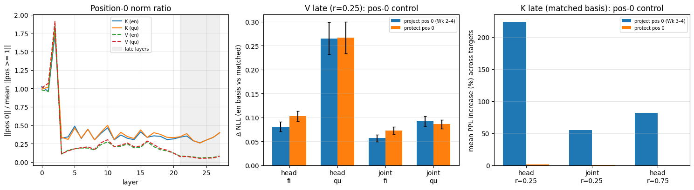
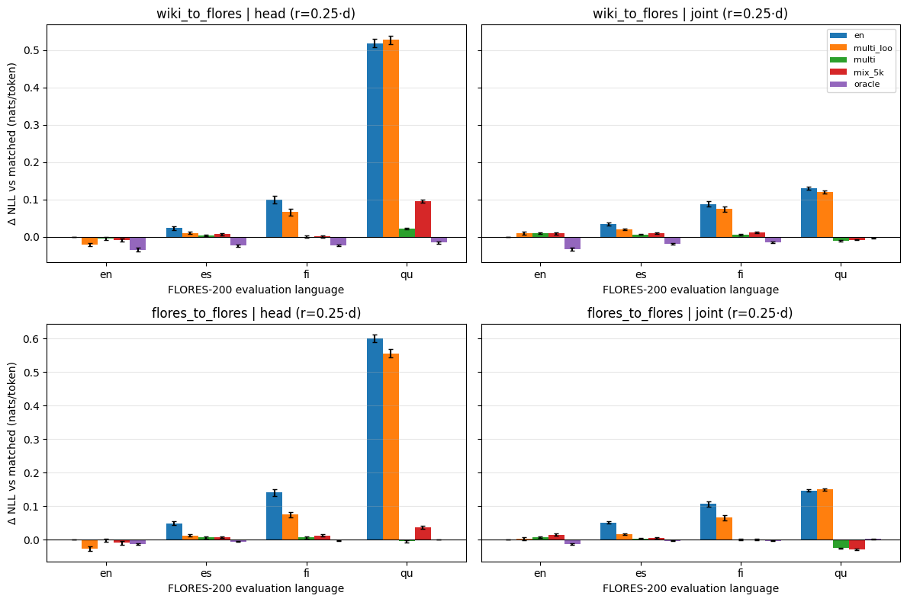
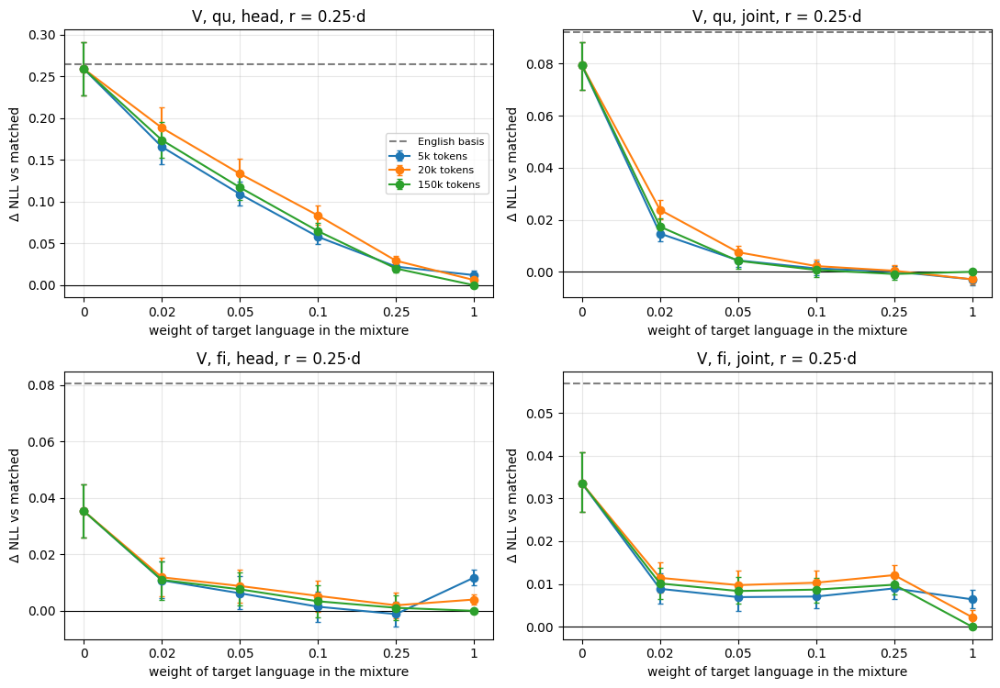

# Cross-Lingual Calibration Bias in Low-Rank KV-Cache Compression for Low-Resource Languages

Systematic empirical study of **low-rank KV-cache compression** across high- and low-resource languages — **English (`en`)**, **Spanish (`es`)**, **Finnish (`fi`)**, and **Ayacucho Quechua (`qu`)** — on **Qwen3-1.7B** (28 layers, 16 query heads, 8 KV heads, `head_dim = 128`).

---

## Core Findings

1. **Values (`V`) carry severe cross-lingual calibration bias; Keys (`K`) are nearly language-agnostic (once position 0 is protected).**
   - Compressing late-layer `V` (layers 21–27, `r = 0.25·d`, 4× reduction) with an English-calibrated basis penalizes Quechua by **`+0.267` nats/token** (`+35.5%` PPL vs `+3.7%` matched) on Wikipedia and **`+0.601` nats/token** (`+75.1%` PPL vs `-4.0%` matched) on parallel **FLORES-200** sentences.
   - Under the same setup (`protect_pos0 = True`), late-layer `K` incurs only `+1.99%` PPL (matched) vs `+4.98%` (English basis) on Quechua — a cross-lingual gap ~9× smaller than `V`.

2. **Attention-sink protection (`protect_pos0 = True`) is critical for low-rank `K` and full-model compression.**
   - Computing Gram matrices with `SKIP_FIRST_TOKENS = 1` while projecting position 0 inside the forward pass caused late-layer `K` perplexity to explode (`+159%` to `+337%` at `r = 0.25`, and `+57%` to `+120%` even at `r = 0.75` oracle).
   - Simply leaving token position `0` uncompressed drops late-layer `K` PPL increase from **`+159–337%` to `+1.15–1.99%`** (`head`, `r = 0.25`) and **`-0.15–0.25%`** (`head`, `r = 0.75`), and rescues all-layer `V` (`joint`, `r = 0.25`) on Quechua from **`+349.7%` to `+7.86%`**.

3. **Shared across-head projection (`joint`) cuts cross-lingual loss by 65–75% at the same rank budget.**
   - Replacing per-head projectors (`r = 0.25·128 = 32` per head) with a single layer-wide KV projector (`r = 0.25·1024 = 256` shared across 8 KV heads) reduces the English-calibration penalty on Quechua from `+0.267` to **`+0.086` nats/token** on Wikipedia (`-68%`) and from `+0.601` to **`+0.147` nats/token** on FLORES-200 (`-76%`).

4. **Multilingual calibration without the target language (`multi_loo`) fails for Quechua — but just ~5k target tokens close the gap.**
   - Averaging English + Spanish + Finnish calibration Grams (`multi_loo`) provides almost no relief to Quechua (`+0.259` vs `+0.265` on Wiki `head`; `+0.556` vs `+0.601` on FLORES `head`).
   - Mixing just **`5k` tokens (~10 windows of 512 tokens)** of Quechua at weight `w = 0.05–0.10` into a `joint` projector eliminates virtually the entire gap:
     - Wikipedia: `ΔNLL = +0.004` (`w = 0.05`), **`+0.001`** (`w = 0.10`).
     - FLORES-200 parallel (`flores_to_flores`): **`ΔNLL = -0.0296`** (`-5.0%` PPL).
     - Cross-domain (`wiki_to_flores`, 5k Wiki Quechua tokens tested on FLORES news): **`ΔNLL = -0.0086`** (`-2.4%` PPL).

5. **The effect is linguistic/representational, not a Wikipedia topic confounder.**
   - Replicating both calibration and evaluation on strictly parallel **FLORES-200** translations (`eng_Latn`, `spa_Latn`, `fin_Latn`, `quy_Latn`) reproduces — and strengthens — every finding from Wikipedia.

---

## Key Figures

### Position-0 Sink Control (`K` & `V`, Week 5 Part A)


### Parallel-Corpus Control on FLORES-200 (`V`, Week 5 Part B)


### Low-Budget Target-Language Mixture Sweep (Week 4 Part A)


---

## Repository Structure

```text
kv-cache-low-resources/
├── README.md
├── requirements.txt
├── .gitignore
├── docs/
│   ├── RESULTS.md                                 # Full quantitative tables across Weeks 1–5
│   └── ROADMAP.md                                 # Next experiments (Week 5b K deep-dive, Llama-3.2, downstream tasks)
├── notebooks/
│   ├── 01_week1_spectra.ipynb                     # Week 1: Per-head & joint K/V spectra (NER, r90/95/99)
│   ├── 02_week1b_subspace_transfer.ipynb          # Week 1b: Cross-lingual subspace overlap & energy transfer
│   ├── 03_week2_intervention_noise_floor.ipynb    # Week 2: Held-out splits, forward-pass projection, bootstrap CIs
│   ├── 04_week3_4_multilingual_and_mixtures.ipynb # Weeks 3–4: multi vs multi_loo, 5k token mixture sweep, soft-rank K
│   ├── 05_week5_pos0_and_flores.ipynb             # Week 5: Position-0 sink control + FLORES-200 parallel control
│   └── 06_week5b_k_deepdive.ipynb                 # Week 5b (ready to run): k_norm anatomy, 4-way pos-0, full-model K+V
└── results/
    └── figures/                                   # All 16 PNG figures extracted from executed notebooks
```

---

## Experimental Timeline & Status

| Notebook | Focus | Status | Runtime (Kaggle T4) |
|---|---|---|---|
| [01_week1_spectra.ipynb](notebooks/01_week1_spectra.ipynb) | K/V singular spectra, NER, cross-lingual Spearman agreement | Done | CPU / ~10 min GPU |
| [02_week1b_subspace_transfer.ipynb](notebooks/02_week1b_subspace_transfer.ipynb) | Subspace overlap & transfer efficiency matrices | Done | ~1 min (CPU) |
| [03_week2_intervention_noise_floor.ipynb](notebooks/03_week2_intervention_noise_floor.ipynb) | Forward-pass low-rank projection, held-out noise floor, paired bootstrap | Done | ~62 min |
| [04_week3_4_multilingual_and_mixtures.ipynb](notebooks/04_week3_4_multilingual_and_mixtures.ipynb) | `multi` vs `multi_loo`, token budget (`5k/20k/150k`) & mixture weight sweep | Done | ~80 min |
| [05_week5_pos0_and_flores.ipynb](notebooks/05_week5_pos0_and_flores.ipynb) | Position-0 sink control (`V` & `K`) + FLORES-200 parallel control | Done | ~58 min |
| [06_week5b_k_deepdive.ipynb](notebooks/06_week5b_k_deepdive.ipynb) | `k_norm` cosine distortion, 4-way pos-0 (`std SVD` vs `protect`), depth bands & full-model `K+V` | Ready to run | ~38–42 min (`QUICK`: ~15 min) |

---

## Reproducing Experiments

All notebooks are self-contained and designed for **Kaggle GPU T4 ×1 (Internet On)** with no Hugging Face authentication token required:

1. Run once with `SMOKE_TEST = True` on CPU (<30 s) to verify the full pipeline on a tiny synthetic Llama model.
2. Switch to GPU T4 ×1 with `SMOKE_TEST = False` (`QUICK = True` for a reduced grid, `QUICK = False` for the full paper grid).
3. See [docs/RESULTS.md](docs/RESULTS.md) for full numerical tables and [docs/ROADMAP.md](docs/ROADMAP.md) for upcoming work (Week 5b `K` deep dive, Llama-3.2 replication, and downstream evaluation on SIB-200 / FLORES translation).
